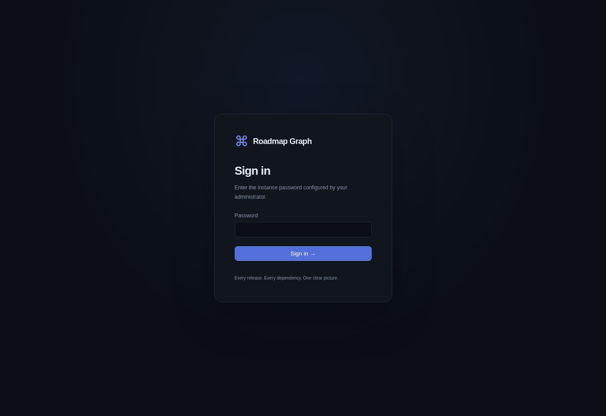

# Roadmap Graph

**See how your products evolve, connect, and depend on each other.**

A lightweight self-hosted roadmap for interconnected products. Each project occupies a horizontal lane; every milestone's horizontal position represents an ISO calendar date. Directed connections run from the prerequisite to the dependent. This is a focused release-planning tool, not an issue tracker.

## Features

- Svelte 5/TypeScript/SVG timeline with permanent dependency edges, hover chains, selection and milestone details.
- Go REST API and persistent SQLite database, foreign keys and migrations.
- Projects, milestones and `requires` / `related_to` relationships; hard-dependency cycle prevention.
- Scheduling-conflict detection and downstream impact analysis.
- Dark/light themes and English/Russian interface.
- Single-user login, HttpOnly sessions and CSRF-protected writes.
- Explicit fictional PROJECT X/COMMON MODULE/PROJECT F/PROJECT Y demo dataset.

Actual verification results and limitations are recorded in [docs/VERIFICATION.md](docs/VERIFICATION.md). Do not interpret this feature overview as evidence that a particular deployment was tested.

Actual application sign-in screen (the authenticated graph screenshot remains unverified):



## Quick start with Docker

Requires Docker Engine with Compose v2.

```sh
cp .env.example .env
# Edit .env: set ROADMAP_PASSWORD to a unique password (12+ characters).
docker compose up --build -d
```

Open <http://localhost:8080> and sign in with that password. The example binds only to loopback. A named volume stores SQLite data. Demo data is never implicitly added to an existing database: set `ROADMAP_DEMO=true` in `.env`, restart, then use the authenticated demo initialization action in an empty application.

For HTTPS behind a trusted reverse proxy, set `ROADMAP_COOKIE_SECURE=true`, forward requests to the loopback endpoint, and terminate TLS at the proxy. Keep the password private. Do not directly expose an HTTP deployment to the Internet.

## Configuration

| Variable | Default | Purpose |
| --- | --- | --- |
| `ROADMAP_PASSWORD` | required | Single-user password, minimum 12 characters; bcrypt hash held in process memory. |
| `ROADMAP_ADDR` | `:8080` | HTTP listen address. |
| `ROADMAP_DB` | `data/roadmap.db` | SQLite file path; parent directory must be writable. |
| `ROADMAP_STATIC` | `../frontend/dist` | Built frontend directory. |
| `ROADMAP_COOKIE_SECURE` | `true` | Secure cookies; set `false` only for local HTTP. |
| `ROADMAP_DEMO` | `false` | Allows explicit demo initialization action on an empty database. Never enable for production. |

The Go executable reads environment variables. Compose reads `.env`; the local root `npm run dev` helper also loads `.env`. The backend rejects startup without a valid password. Sessions expire after 12 hours and are invalidated when the process restarts. Database contents survive restarts.

## Local development

Requires Node.js 22+, a supported Go release (Docker uses Go 1.27.3; module language baseline 1.24), a C compiler and SQLite driver build prerequisites (Debian `build-essential`). SQLite itself is bundled by the Go driver; a separate database service is unnecessary.

```sh
cd frontend
npm ci
npm run check
npm test
npm run build
cd ../backend
go test ./...
go build -o roadmap ./cmd/roadmap
cd ..
cp .env.example .env
# Set password in .env, then:
npm run dev
```

The single-origin development runner serves built frontend assets at <http://localhost:5173>. Rebuild frontend assets and the Go binary after changes. Alternatively run the backend on port 8080 and `npm run dev` inside `frontend` for Vite hot reload; Vite proxies `/api` to the backend.

## Tests

```sh
(cd backend && go test -race ./...)
(cd frontend && npm run check && npm test && npm run build)
```

The Playwright journey is in `frontend/tests/e2e/core.spec.ts`. Start an isolated, empty test database first; this test creates persistent records.

```sh
cd frontend
npx playwright install chromium
ROADMAP_TEST_URL=http://127.0.0.1:5173 \
ROADMAP_TEST_PASSWORD='your-isolated-test-password' npm run test:e2e
```

In managed ChatGPT Work environments use the provided preview/browser route; do not install an alternative browser route to bypass environment restrictions. See the verification report for which commands actually ran here.

## Data persistence, backup and restore

The Compose volume `roadmap-data` contains the SQLite database and WAL files. Deleting the container preserves this volume. `docker compose down -v` deletes the data.

Use a consistent backup: stop the service before copying the volume, or use SQLite's online backup API. Do not copy only the main `.db` file from a running WAL database.

```sh
docker compose stop roadmap
mkdir -p backups
docker compose run --rm -T --no-deps --entrypoint tar \
  roadmap -C /data -czf - . > backups/roadmap-data.tar.gz
docker compose start roadmap
```

Restore into an empty volume while the service is stopped:

```sh
docker compose stop roadmap
docker compose run --rm -T --no-deps --entrypoint tar \
  roadmap --no-same-owner -C /data -xzf - < backups/roadmap-data.tar.gz
docker compose start roadmap
```

Keep backups and `.env` separately, with restricted access. Reuse an image built from the same release when restoring.

## Architecture and API

The runtime is one Go process serving both static frontend assets and the authenticated REST API. SQLite uses WAL, foreign keys and schema migrations. The frontend uses date-only UTC arithmetic, SVG paths and indexed graph traversal.

- [Architecture and security](docs/ARCHITECTURE.md)
- [REST API](docs/API.md)
- [Verification and acceptance evidence](docs/VERIFICATION.md)
- [Development roadmap](docs/ROADMAP.md)

## Known limitations

Single-user authentication only; no RBAC or SSO. Sessions are in memory. Multi-instance deployment is unsupported. This MVP does not infer delivery dates or automatically move downstream releases. A conflict indicates an inconsistent plan, not a confirmed real-world delay. Large-graph readability and label collisions deserve further work. See the verification report for unverified deployment behavior.

## License

Original project source: Apache-2.0, see [LICENSE](LICENSE). Third-party dependencies retain their own licenses; lockfiles identify the dependencies. No proprietary reference branding or assets are included.

## Yandex Tracker

Optional bidirectional synchronization is disabled by default. Supply `ROADMAP_TRACKER_TOKEN` only to the backend, then configure the organization, selections, project grouping and explicit field/status/link mappings in Settings → Yandex Tracker. Preview and confirm imports before synchronizing. Milestone details expose publication, exclusion, synchronization errors and per-field conflict resolution. Existing local data and simulations work without Tracker.

See [setup, mapping and recovery guide](docs/TRACKER.md) for authentication, concurrency guarantees, deletion behavior, retries, limits and test-organization acceptance checks.

## Diagnostics

Use `ROADMAP_LOG_LEVEL=debug` for backend request/synchronization metadata and `docker compose logs -f --tail=100 roadmap` to view it. Recreate the container after changing its environment. Open `/?debug=1` for timeline counts, filters, date-window and viewport diagnostics. See [debugging guide](docs/TRACKER.md#debugging-missing-milestones-and-unsaved-settings).
